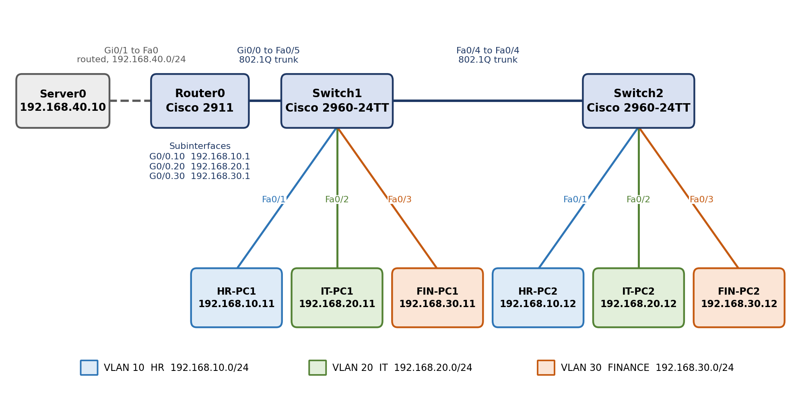
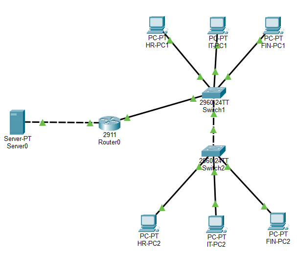

# Secure Office Network: VLANs and Inter-VLAN Routing

Cisco Packet Tracer lab that segments a small office into HR, IT and Finance VLANs across two switches, connects them with 802.1Q trunks, and routes between them with Router-on-a-Stick, then tests the result and traces a routed packet hop by hop.

**Prepared by:** Awe Oluwasanmi Mayokun  **Classification:** Personal / Educational Lab Project

---

## Scope & Lab Environment

Everything in this project was built and tested inside **Cisco Packet Tracer**. No physical devices, production systems or third-party networks were involved. The repository is published for educational and portfolio purposes: it documents design, configuration, testing and troubleshooting of a simulated network.

---

## Table of Contents

- [Overview](#overview)
- [Objective](#objective)
- [Tools & Environment](#tools--environment)
- [Network Design](#network-design)
- [Methodology](#methodology)
- [Results](#results)
- [Packet-Flow Highlights](#packet-flow-highlights)
- [Troubleshooting Highlights](#troubleshooting-highlights)
- [Repository Structure](#repository-structure)
- [Reproducing the Lab](#reproducing-the-lab)
- [Viewing the Report](#viewing-the-report)
- [Acknowledgement](#acknowledgement)
- [About Me](#about-me)
- [License](#license)

---

## Overview

A small company has three departments, Human Resources, Information Technology and Finance, that share one flat network. Every broadcast reaches every device and nothing separates sensitive records from general traffic. This project redesigns that network so each department has its own VLAN and subnet, spread across two switches so the departments do not depend on a single physical location. One router connects the VLANs through subinterfaces on a single port, and a shared server on its own routed subnet extends the design.

## Objective

- Segment the office into three VLANs with one subnet each.
- Spread every department across two switches, so the inter-switch trunk is genuinely needed.
- Provide inter-VLAN routing with one physical router port and three subinterfaces.
- Verify connectivity, isolation and failure behaviour with a structured test plan.
- Trace one routed packet to show how MAC addresses, VLAN tags and IP addresses behave at each hop.
- Extend the network with a shared server.

## Tools & Environment

- **Cisco Packet Tracer**
- 1 x Cisco 2911 router, 2 x Cisco 2960-24TT switches, 6 x PC-PT, 1 x Server-PT
- IOS commands: `show vlan brief`, `show interfaces trunk`, `show interfaces status`, `show mac address-table`, `show ip interface brief`, `show ip route`, `show interfaces`, `show running-config`
- Packet Tracer **Simulation Mode** for ARP and ICMP packet inspection

## Network Design



| VLAN | Name | Department | Network | Gateway |
|---|---|---|---|---|
| 10 | HR | Human Resources | 192.168.10.0/24 | 192.168.10.1 (G0/0.10) |
| 20 | IT | Information Technology | 192.168.20.0/24 | 192.168.20.1 (G0/0.20) |
| 30 | FINANCE | Finance | 192.168.30.0/24 | 192.168.30.1 (G0/0.30) |
| none | Servers | Shared services (routed port) | 192.168.40.0/24 | 192.168.40.1 (G0/1) |

| Link | Endpoint A | Endpoint B | Mode |
|---|---|---|---|
| Switch to switch | Switch1 Fa0/4 | Switch2 Fa0/4 | 802.1Q trunk, VLANs 10, 20, 30 |
| Router uplink | Switch1 Fa0/5 | Router0 Gi0/0 | 802.1Q trunk, split into subinterfaces .10, .20, .30 |
| Server link | Router0 Gi0/1 | Server0 Fa0 | Routed, untagged |

Each switch carries one PC from every department, so the Fa0/4 trunk is essential. Full host addressing is in [`docs/implementation_guide.md`](docs/implementation_guide.md).



## Methodology

1. Build and cable the topology.
2. Create VLANs 10, 20 and 30 on both switches and assign the access ports.
3. Configure 802.1Q trunks between the switches and from Switch1 to the router.
4. Address the hosts statically.
5. Configure Router-on-a-Stick with one subinterface per VLAN.
6. Add the server on its own routed subnet.
7. Verify with the show commands, run Tests A to E, and save the configurations.

The full step-by-step procedure, with every command, is in [`docs/implementation_guide.md`](docs/implementation_guide.md).

## Results

| Test | Description | Result |
|---|---|---|
| A | Same-VLAN pings (HR, IT, Finance pairs across the trunk) | **Passed:** 4 of 4 replies, TTL 128 (no router in the path) |
| B | Inter-VLAN pings (HR to IT, HR to Finance, Finance to HR) | **Passed:** TTL 127 (one router hop); the first request can time out while ARP resolves |
| C | Shut down router Gi0/0, then restore it | **Passed:** same-VLAN traffic unaffected, inter-VLAN traffic fully blocked, restored after `no shutdown` |
| D | Simulation Mode packet-flow analysis | **Completed:** ARP, 802.1Q tagging, MAC rewrite and unchanged IPs all observed |
| E | Server reachable from every VLAN | **Passed:** replies from 192.168.40.10, TTL 127 |

Evidence for each test is in [`screenshots/06_tests/`](screenshots/06_tests/) and [`screenshots/07_simulation/`](screenshots/07_simulation/).

## Packet-Flow Highlights

- **ARP stays inside the VLAN.** HR-PC1 resolves its gateway with a broadcast to `FFFF.FFFF.FFFF`, which reaches only HR-PC2 and the router. IT devices never see it.
- **The trunk tags frames.** Switch1 adds an 802.1Q tag (VLAN 10, TCI `0x000a`) when it forwards HR traffic to the router, and the router sends the frame back tagged for VLAN 30 (TCI `0x001e`). The tag is removed at the access port toward FIN-PC1.
- **MAC addresses change at the router; IP addresses do not.** Source and destination MACs are rewritten at every hop, while 192.168.10.11 to 192.168.30.11 stays constant end to end. The TTL drops by one at the router.

## Troubleshooting Highlights

- **Trunk showed `notconnect`** because router ports are shut down by default. Fixed with `no shutdown`.
- **Subinterface address rejected** because the VLAN encapsulation must be configured first.
- **Empty MAC tables** because entries had aged out. Fresh traffic repopulated them.

All eight faults, with causes and fixes, are in [`docs/troubleshooting_log.md`](docs/troubleshooting_log.md).

## Repository Structure

```
.
├── README.md
├── LICENSE
├── packet-tracer/                  # Packet Tracer (.pkt) file goes here
├── reports/
│   ├── VLAN_Routing_Project_Report.pdf   # full report (primary deliverable)
│   └── VLAN_Routing_Project_Report.docx
├── docs/
│   ├── VLAN_Routing_Project_Brief.pdf    # project brief
│   ├── VLAN_Routing_Project_Brief.docx
│   ├── implementation_guide.md           # step-by-step build guide
│   └── troubleshooting_log.md            # faults, causes and fixes
├── diagrams/
│   └── logical_topology.png
├── configs/
│   ├── Router0.txt
│   ├── Switch1.txt
│   ├── Switch2.txt
│   └── vlan_database.txt                 # VLAN definitions (not in running-config)
└── screenshots/                          # evidence, unaltered (see its README)
    ├── 01_topology/   ├── 02_vlans/   ├── 03_trunks/   ├── 04_hosts/
    └── 05_router/     ├── 06_tests/   ├── 07_simulation/   └── 08_troubleshooting/
```

## Reproducing the Lab

- **Open the finished lab:** open the `.pkt` file in [`packet-tracer/`](packet-tracer/) with Cisco Packet Tracer.
- **Rebuild from scratch:** follow [`docs/implementation_guide.md`](docs/implementation_guide.md). The files in [`configs/`](configs/) are the final saved configurations, for reference and comparison. Apply [`vlan_database.txt`](configs/vlan_database.txt) first on a rebuilt switch.

## Viewing the Report

The full report covers the design, the implementation guide, verification of the build, all five tests with the packet-flow analysis, the troubleshooting log, and the conclusion. It is in [`reports/`](reports/). GitHub previews PDF files directly in the browser; no download needed.

## Acknowledgement

This project is adapted from a VLAN and inter-VLAN routing exercise in Devtown's "Networking Basics for Cybersecurity" course material. The addressing, configuration, testing and documentation here were carried out and extended independently, including the shared server, the verification of MAC address tables and the packet-level analysis.

## About Me

**Awe Oluwasanmi Mayokun** builds practical cybersecurity and networking skills through hands-on labs.

- GitHub: [https://github.com/CyberAce001](https://github.com/CyberAce001)
- LinkedIn: [https://www.linkedin.com/in/oluwasanmiawe/](https://www.linkedin.com/in/oluwasanmiawe/)

## License

This repository is licensed under the [MIT License](LICENSE).
